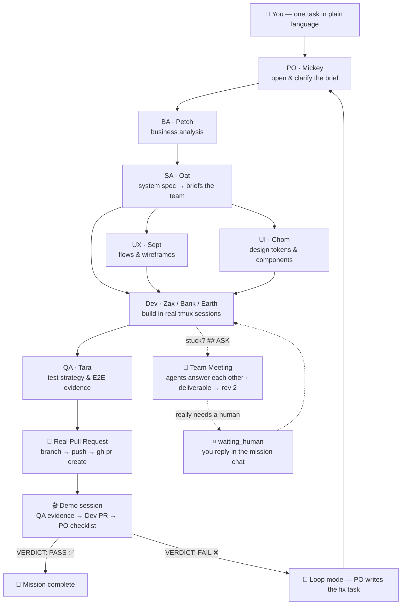
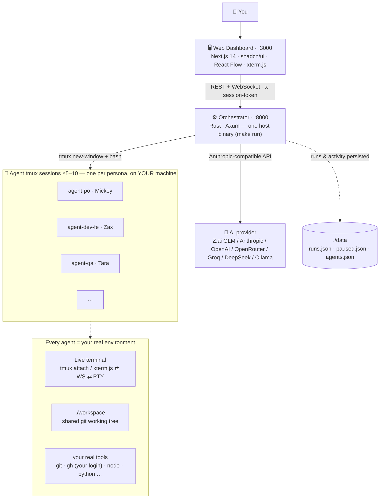

# AI Agent Platform

**A 9-agent AI software team that works on YOUR machine — real tmux sessions you can watch, a real git repo, real pull requests. No Docker.**

Give the team one task in plain language. The Product Owner opens the brief, the Analysts break it down, Designers and Developers build it in their own tmux sessions on your Mac, QA verifies it — then a real PR is opened and the PO runs a demo session to accept (or reject) the delivery with a verdict.

[](docs/screenshots/mission-control.png)

*A live mission on the React Flow canvas — each agent is a node, the timeline streams what they're doing, and meetings appear as floating cards wired to everyone involved.*

---

## 📸 The platform

| | |
|---|---|
| [](docs/screenshots/dashboard.png) | [](docs/screenshots/container-detail.png) |
| **Dashboard** — every agent at a glance: state, role, live status. | **Agent terminal** — the agent's live tmux session inside the page: watch every command stream by, or `tmux attach` yourself. |
| [](docs/screenshots/team.png) | [](docs/screenshots/board.png) |
| **AI Team** — 9 personas with role, model, skills and their own session. Edit personas in-place. | **Orchestrator board** — Kanban + live activity feed of what every agent is doing right now. |

## ✨ Highlights

- 🧑‍🚀 **9 role-playing agents, one real workflow** — PO → BA → SA → UX/UI → Dev → QA, each working in their *own* tmux session on your machine, each writing deliverables to a shared git working tree
- 🖥 **Live terminals** — every agent is a real shell in a tmux session (`agent-<role>`); you watch them work in the web terminal (xterm.js ⇄ WebSocket ⇄ PTY) or `tmux attach` directly — several viewers at once, nothing fights
- 🧠 **Team meetings & human-in-the-loop** — a stuck agent opens an `ASK` meeting and *other agents answer*; if it truly needs you, the run pauses (`waiting_human`) and your inbox pings — answer in the mission chat and the team continues
- 🐙 **Real pull requests** — the Dev creates a branch, pushes and opens a PR with `gh` using YOUR GitHub login. No PR theater: if prerequisites are missing the step is *honestly skipped with the real reason*
- 🎬 **Acceptance demo** — QA and Dev present their evidence in a **demo session** while the PO checks acceptance criteria one by one → `VERDICT: PASS|FAIL`
- 🔁 **Loop mode** — after each round the PO evaluates the goal, writes the next task itself and re-runs the team (up to 8 rounds); a FAIL verdict forces a fix task
- 🔌 **Connectors** — GitHub (browser device-flow or PAT) and Figma (PAT) — **one machine, one identity**: log in once and the whole team pushes with your account
- 🛡 **Honest tools** — before every step the orchestrator probes what's really installed on your machine and puts a *tools manifest* in the prompt: what exists (with versions) and what's forbidden to guess. Kills tool hallucination
- 🌐 **Any AI provider** — Z.ai GLM, Anthropic, OpenAI, OpenRouter, Groq, DeepSeek, Ollama (local) or a custom endpoint; switchable per persona from the AI Config page, keys stored server-side
- 🔐 **Login gate** — one `ADMIN_PASSWORD` unlocks everything (API, terminals)
- 🪶 **Zero Docker** — agents are shell sessions, not containers: no images to build, no VM tax, idle agents cost nothing; what's installed on your Mac is what the team can use

## 🎬 How a mission runs



Everything streams live into Mission Control: agent nodes light up blue (working) / amber (meeting) / green (delivered), the timeline shows each step with its real output, and every run is persisted (`data/runs.json`) so history survives restarts.

## 🏗 Architecture



| Component | Stack | What it does |
|---|---|---|
| **Web** ([web/](web/)) | Next.js 14 (App Router), Tailwind, shadcn/ui, React Flow, xterm.js | Dashboard, Mission Control, team & persona editor, Kanban board, settings, AI config, connectors |
| **Orchestrator** ([orchestrator/](orchestrator/)) | Rust, Axum 0.8, tokio, portable-pty — a single host binary | Agent (tmux session) lifecycle, the Team Run engine (missions, meetings, loop mode, PR/demo stages), auth, connectors, tools manifest. Exec seam lives in [src/hostexec.rs](orchestrator/src/hostexec.rs) |

**Design principles**

- *One machine, one identity* — agents run with your real `$HOME`, your real tools, your real GitHub login; there is no per-agent sandbox to maintain, and nothing is ever installed behind your back (the tools manifest only *probes*)
- *Repo-first* — the orchestrator clones the project repo (depth 1) into a **shared `./workspace` directory**, so the whole team works on one working tree
- *Everything real* — deliverables, commits, PRs and test evidence are real artifacts; skipped stages say why
- *tmux = the window* — every command an agent runs is visible in its session, live, whether you watch from the web UI or your own terminal

## 👥 The AI team

| Role | Agent | Owns |
|---|---|---|
| Product Owner | **Mickey** | Opens the brief, coordinates, writes the mission summary, delivers the acceptance verdict |
| Business Analyst | **Petch** | Business requirements, success metrics, risks |
| System Analyst | **Oat** | Turns business → system spec (data model, API contracts), briefs the builders |
| UX Designer | **Sept** | User flows, IA, wireframes, unhappy paths |
| UI Designer | **Chom** | Visual design, design tokens, components |
| Frontend Dev | **Zax** | UI + API integration |
| Backend Dev | **Bank** | Services, API design, observability |
| Backend Dev | **Earth** | Data, migrations, CI/CD, reliability |
| QA Engineer | **Tara** | Test strategy, E2E (Playwright), quality gates |

Personas are editable from the AI Team page — role prompt, model, skills.

## 🚀 Quickstart

```bash
git clone https://github.com/9zax/ai-agent-platform.git
cd ai-agent-platform

cp .env.example .env       # optional: set AI_API_KEY / ADMIN_PASSWORD now,
                           # or configure everything in the web UI later

make build                 # cargo release build + web production build
make run                   # orchestrator :8000 + web :3000, host processes
```

| Service | URL |
|---|---|
| Web dashboard | http://localhost:3000 |
| API | http://localhost:8000 |
| Any agent, live | `tmux attach -t agent-dev` |

Start agents from the AI Team page (or the dashboard), open a project, type a task, press **สั่งงานทีม**, and watch Mission Control — or attach to any `agent-<role>` session and watch the same thing from your own terminal.

<details>
<summary><b>Environment variables</b> (all optional at boot)</summary>

| Variable | Default | Meaning |
|---|---|---|
| `AI_API_KEY` | *(empty)* | Provider API key — or set it in the **AI Config** page |
| `AI_BASE_URL` | *(empty)* | Custom endpoint — empty = provider default |
| `ADMIN_USER` | `admin` | Login username |
| `ADMIN_PASSWORD` | *(empty)* | **Empty = auth off.** Set it to require login for the whole platform (API, terminals) |
| `DATA_DIR` | `./data` | Where runs.json / paused.json / agents.json live |
| `AAP_WORKSPACE` | `./workspace` | The team's shared working tree (cloned repos + deliverables) |

</details>

## 🔐 Security notes

- The login gate covers *all* agent endpoints — exec, AI commands, lifecycle, terminals
- Provider keys and GitHub PATs live server-side in the orchestrator, never in the repo; the UI only shows masked keys; tokens injected into clone URLs are kept out of logs
- Secrets passed to an agent command ride a 0600 script file — never a command line (`ps` shows nothing)
- **One machine, one identity is a stated trade-off**: connecting GitHub logs the team in as you; disconnecting (or `gh auth logout`) logs the *machine* out. Agents work with your user's full permissions — this is a deliberate single-user design

## 🧪 Tests

```bash
make test    # runs the Playwright suite with .env credentials (needs the platform running)
```

**~40 tests / 14 spec files** — auth, dashboard, agent detail, AI team, projects, board, connectors, inbox, platform, plus mission dispatch, pause/resume and PR-auth flows.

## 📁 Repository layout

```
├── orchestrator/        # Rust backend (Axum) — API + mission engine + host exec
│   └── src/main.rs      #   (exec seam: src/hostexec.rs — tmux + bash)
├── web/                 # Next.js dashboard
│   ├── app/             # pages: dashboard, projects, containers, team, board, settings…
│   ├── components/      # sidebar, agent detail, human inbox, terminal panel, ui kit
│   └── e2e/             # Playwright specs
├── Makefile             # make build / run / test / migrate-state
├── docs/screenshots/    # the images in this README
└── SPEC.md              # living spec & progress log (Thai)
```

## 🗺 Status & roadmap

Working today: the full loop above — team missions, meetings, human-in-the-loop, loop mode, real PRs, demo acceptance, connectors, persisted history, E2E suite — all on plain host processes.

Not built yet: vision/screenshot capability for agents, GitHub OAuth permission-approval flow, DB-backed persistence for personas/config (currently in-memory + JSON files).

Detailed progress log lives in [SPEC.md](SPEC.md).

---

**Repository:** https://github.com/9zax/ai-agent-platform
