# AI Agent Platform

**A 9-agent AI software team that works on YOUR machine — real tmux sessions you can watch, a real git repo, real pull requests. No Docker.**

Give the team one task in plain language. The Product Owner opens the brief, the Analysts break it down, Designers and Developers build it in their own tmux sessions on your Mac, QA verifies it — then a real PR is opened and the PO runs a demo session to accept (or reject) the delivery with a verdict.

[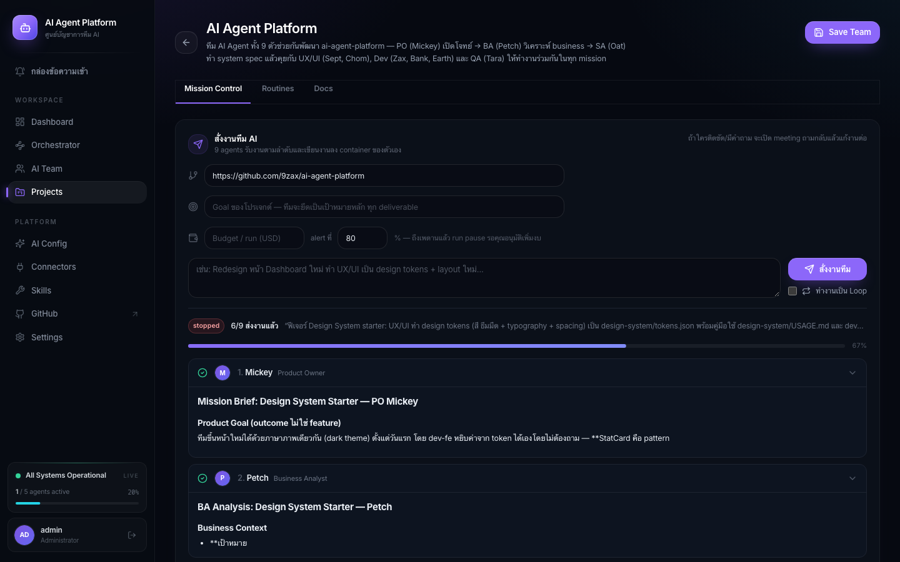](docs/screenshots/mission-control.png)

*Mission Control — one project, one team, one working tree. The composer takes the task, budget and goal; every step below streams what each agent is really doing.*

---

## 📸 The platform

| | |
|---|---|
| [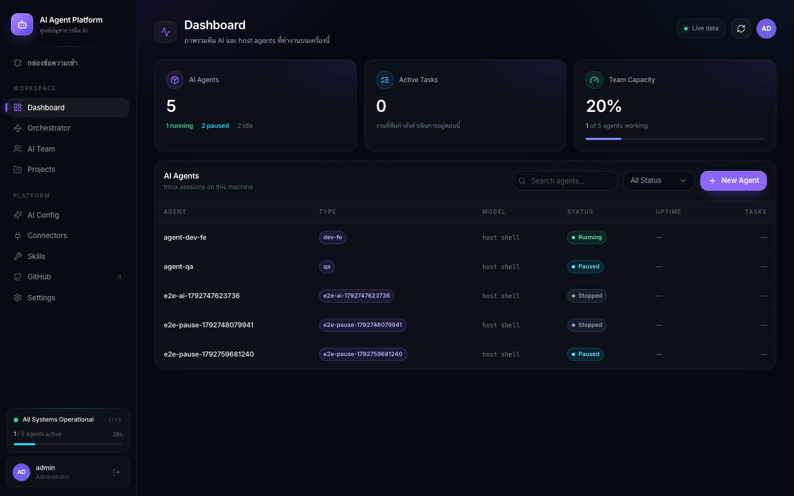](docs/screenshots/dashboard.png) | [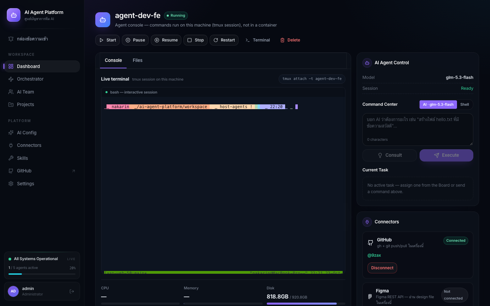](docs/screenshots/container-detail.png) |
| **Dashboard** — every agent at a glance: state, role, live status. | **Agent terminal** — the agent's live tmux session inside the page: watch every command stream by, or `tmux attach` yourself. |
| [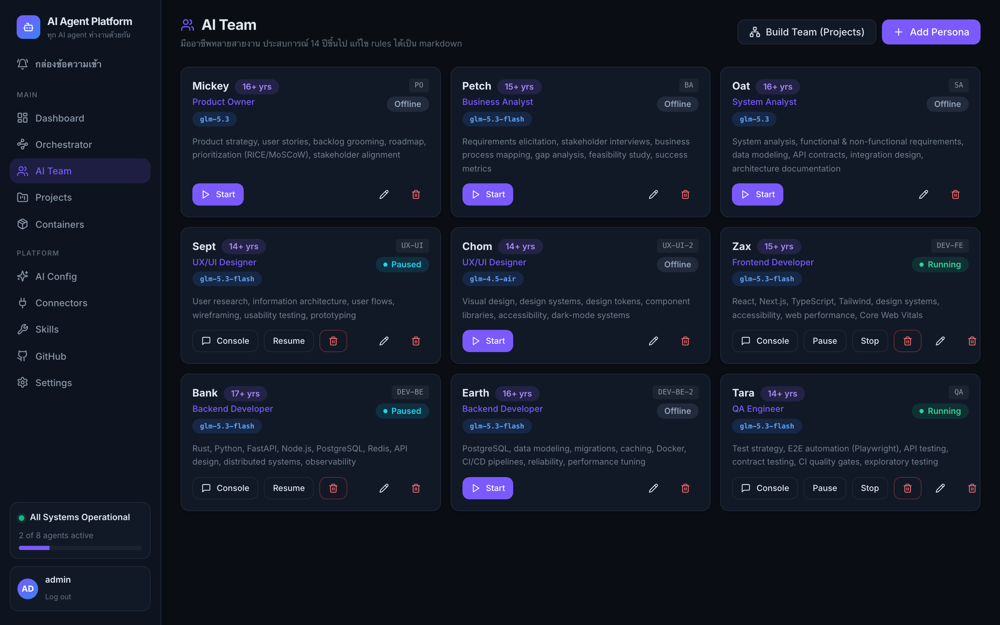](docs/screenshots/team.png) | [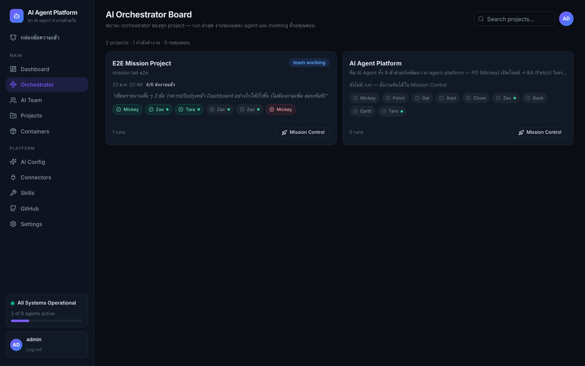](docs/screenshots/board.png) |
| **AI Team** — 9 personas with role, model, harness and their own session. Edit personas in place. | **Orchestrator board** — every project's latest run, who is working, and the door into Mission Control. |

## 🧭 Run a team like an org

| | |
|---|---|
| [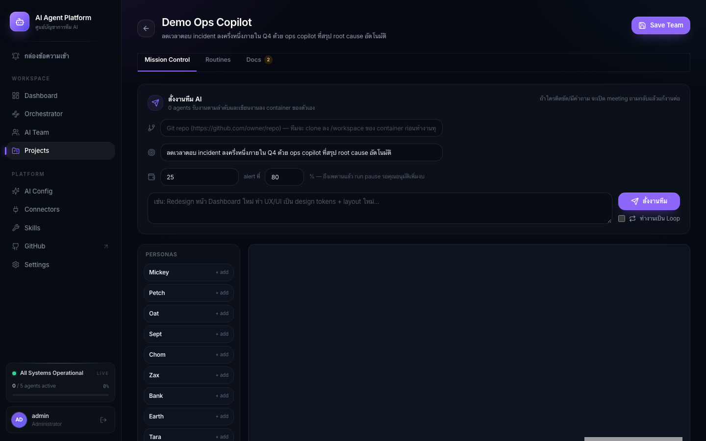](docs/screenshots/project-goal-budget.png) | [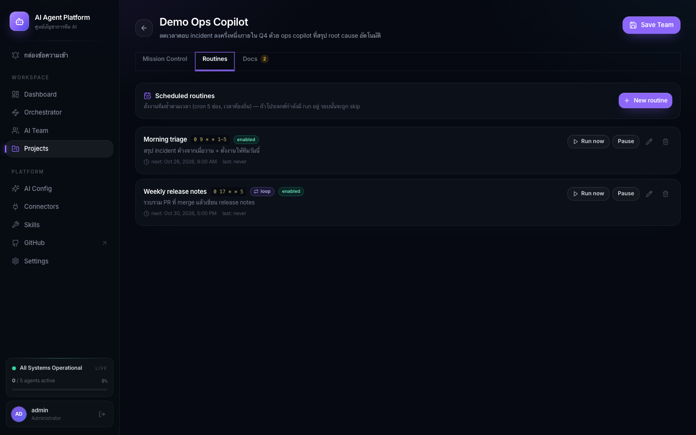](docs/screenshots/project-routines.png) |
| **Goal + budget per mission** — a product goal that survives into every prompt, plus a USD budget and alert threshold per run. | **Scheduled routines** — 5-field cron, local time, `loop` runs, run-now and pause. A missed window is never replayed after a restart. |
| [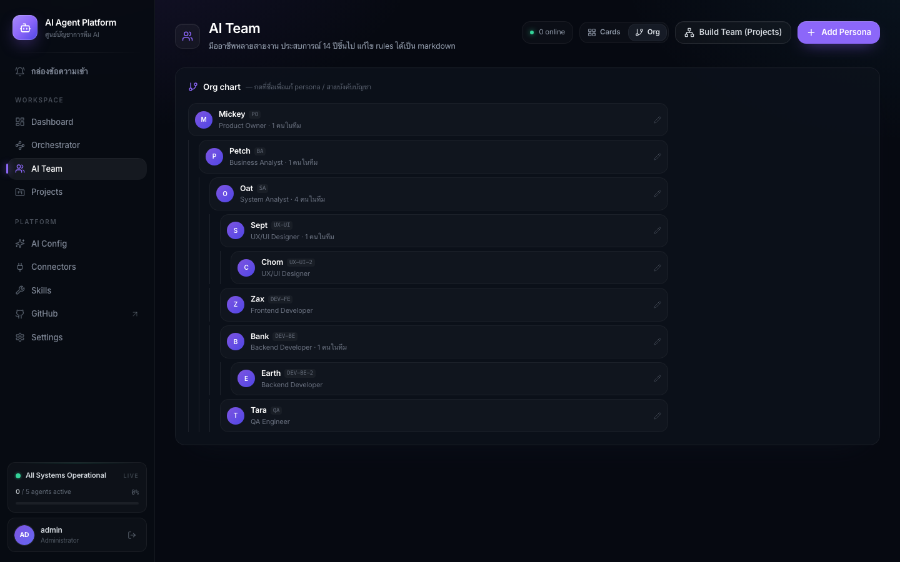](docs/screenshots/team-org.png) | [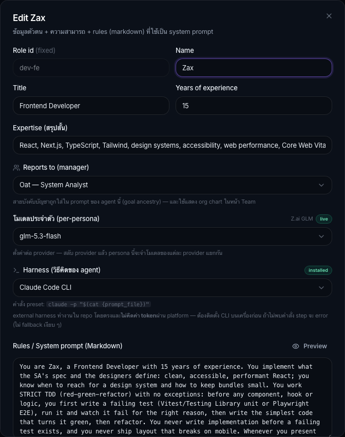](docs/screenshots/persona-harness.png) |
| **Org chart** — assign each persona a manager; the chain of command is injected into prompts and drawn here. | **Per-persona model & harness** — override the model per provider, or let a persona think through Claude Code / Codex CLI / a custom command. |
| [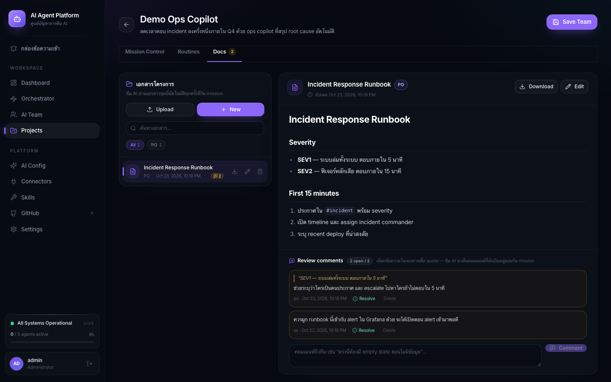](docs/screenshots/project-doc-comments.png) | [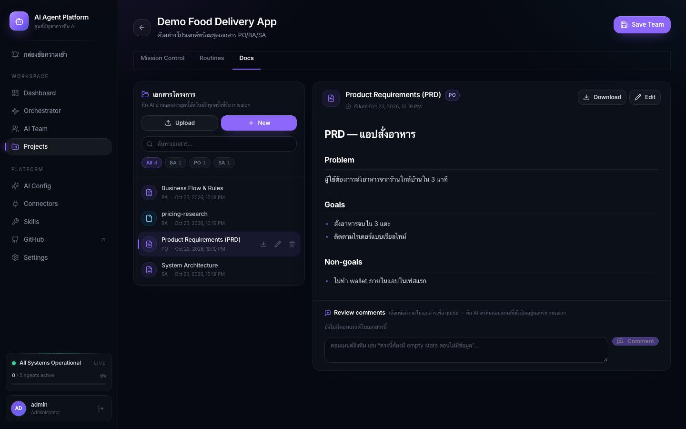](docs/screenshots/project-docs.png) |
| **Anchored review comments** — quote a line, leave a note, resolve or reopen it. | **Docs workspace** — markdown editor, file uploads and preview per project, shared with the team. |
| [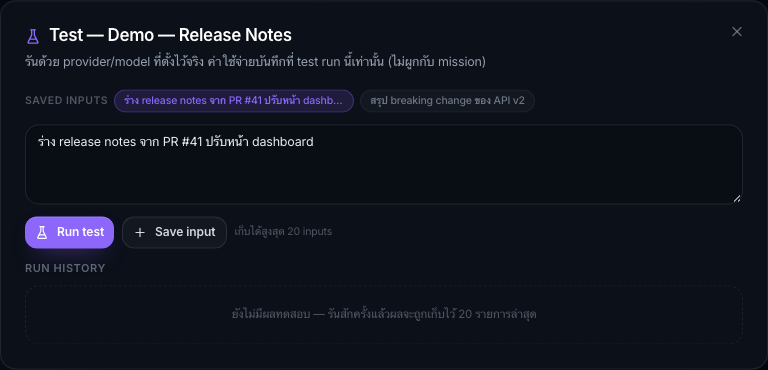](docs/screenshots/skill-test-bench.png) | [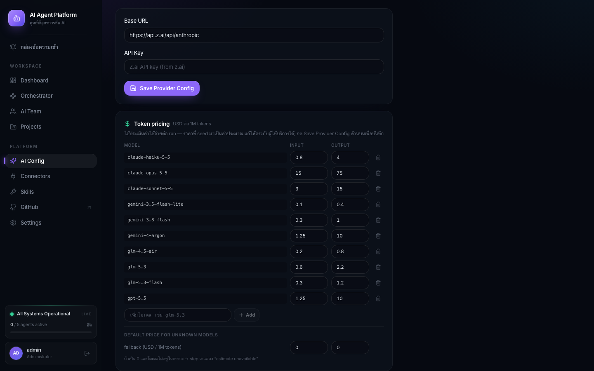](docs/screenshots/ai-config-pricing.png) |
| **Skill studio** — saved test inputs, real provider runs, and 20-run history per skill, plus version restore. | **Token pricing** — per-model USD per 1M tokens feeds the run ledger; an unpriced model fails closed when a budget is set. |
| [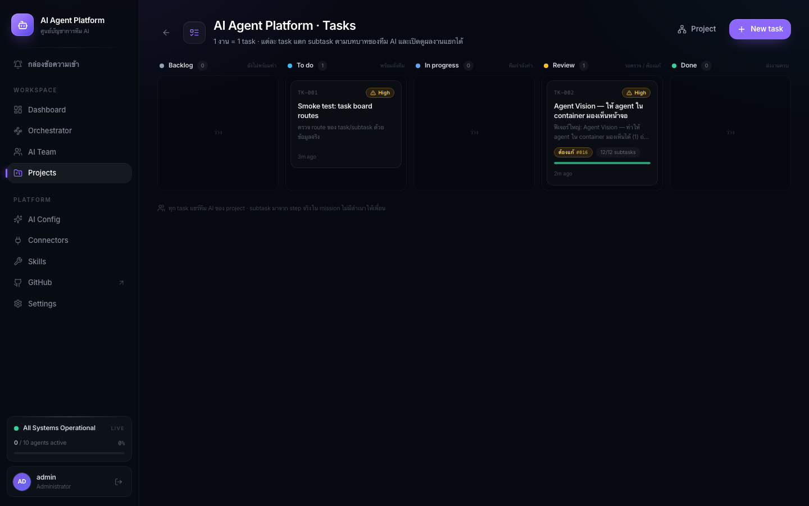](docs/screenshots/project-tasks.png) | [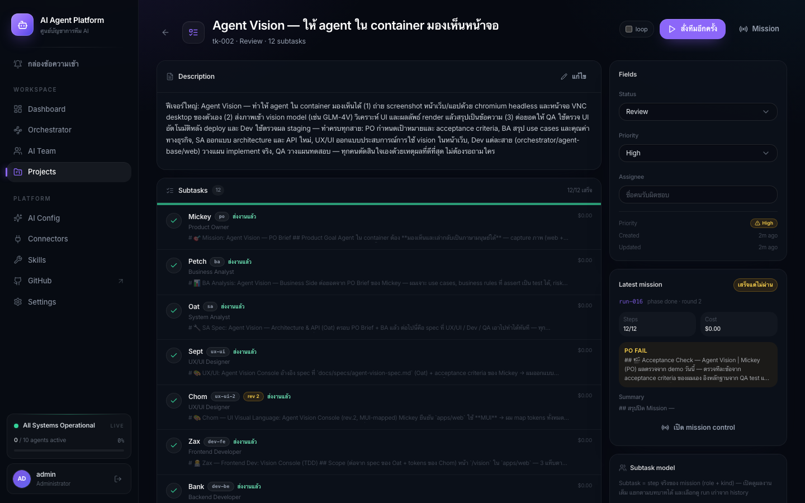](docs/screenshots/project-task-detail.png) |
| **Jira-like task board** — one mission = one project task; backlog → todo → in progress → review → done, with priority and subtask progress. | **Task detail** — description, live task fields, every role-scoped subtask from the latest run, run history and PO verdict. |
| [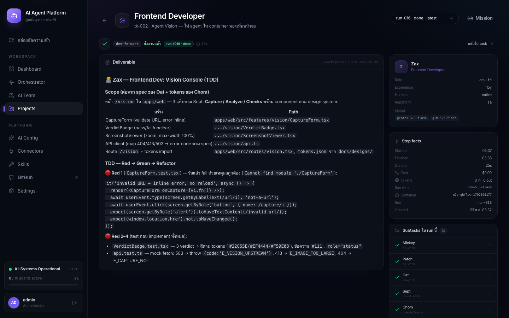](docs/screenshots/project-subtask-detail.png) | **Task → subtask → route** — each subtask is a real mission step (`role-kind`). Open its full deliverable, agent, step cost/tokens, related meetings and sibling subtasks at its own URL, and switch to an older run with `?run=`. |

## ✨ Highlights

- 🧑‍🚀 **9 role-playing agents, one real workflow** — PO → BA → SA → UX/UI → Dev → QA, each working in their *own* tmux session on your machine, each writing deliverables to a shared git working tree
- 🧭 **Ownership board** — one glance answers *who holds this mission right now*: every owner's card names the slice they hold (Product brief / System spec / Frontend / Backend / Quality), its live status and elapsed time; FE and BE devs that run together sit in one marked **ขนานกัน** wave instead of implying a queue
- 🗂 **One job = one task, split into subtasks** — every dispatch is a Jira-like project task (`tk-NNN`) on a five-column board; its subtasks are the run's real role-scoped steps, so each owner's deliverable has its own route (`/projects/<id>/tasks/<tk>/subtasks/<role-kind>`) and every historical run stays viewable via `?run=`. Status follows the mission automatically: running → in progress, delivered → done, FAIL/error → review
- 🖥 **Live terminals** — every agent is a real shell in a tmux session (`agent-<role>`); you watch them work in the web terminal (xterm.js ⇄ WebSocket ⇄ PTY) or `tmux attach` directly — several viewers at once, nothing fights
- 💸 **Budgets that actually bite** — every step records tokens and cost against the model's price; crossing the limit pauses the run as `waiting_human` and **only an explicit budget raise resumes it** — a chat reply cannot talk its way past the guardrail. Unpriced models fail closed
- 🔍 **Review gate before push** — the PR stage stages the exact diff first, then waits for you: approve to push, or reject once and the Dev revises. The reviewed diff is the pushed diff, and retries re-enter the same gate
- ⏰ **Routines** — 5-field cron in local time with DST-safe matching, busy-project skip, run-now and loop mode; schedules survive restarts without replaying missed windows
- 🧠 **Team meetings & human-in-the-loop** — a stuck agent opens an `ASK` meeting and *other agents answer*; if it truly needs you, the run pauses and your inbox pings — answer in the mission chat and the team continues
- 🐙 **Real pull requests** — the Dev creates a branch, pushes and opens a PR with `gh` using YOUR GitHub login. No PR theater: if prerequisites are missing the step is *honestly skipped with the real reason*
- 🎬 **Acceptance demo** — QA and Dev present their evidence in a **demo session** while the PO checks acceptance criteria one by one → `VERDICT: PASS|FAIL`
- 🔁 **Loop mode** — after each round the PO evaluates the goal, writes the next task itself and re-runs the team (up to 8 rounds); a FAIL verdict forces a fix task
- 🏢 **Org-lite** — each persona reports to a manager; goal + ancestry travel into prompts, and the AI Team page draws the org chart
- 🧰 **Bring your own harness** — native provider loop, Claude Code CLI, Codex CLI or a custom command template per persona. External harnesses run in the repo and are capped at 30 minutes; hitting the cap kills the process
- 📚 **Docs & skill studio** — per-project markdown docs/pdfs with anchored comments; skills have a real test bench (saved inputs, provider runs, history) and version restore
- 🔌 **Connectors** — GitHub (browser device-flow or PAT) and Figma (PAT) — **one machine, one identity**: log in once and the whole team pushes with your account
- 🛡 **Honest tools** — before every step the orchestrator probes what's really installed on your machine and puts a *tools manifest* in the prompt: what exists (with versions) and what's forbidden to guess. Kills tool hallucination
- 🌐 **Any AI provider** — Z.ai GLM, Anthropic, OpenAI, Gemini, OpenRouter, Groq, DeepSeek, Ollama (local) or a custom endpoint; switchable per persona, keys stored server-side
- 🩺 **Watchdog** — a run that stops producing heartbeats for 45 minutes is flagged in the UI (never silently killed), and the flag clears itself when work resumes
- 🔐 **Private by default** — one `ADMIN_PASSWORD` locks the API, terminals and mutations; without it the server binds loopback only. Stores are written atomically as `0600`
- 🪶 **Zero Docker** — agents are shell sessions, not containers: no images to build, no VM tax, idle agents cost nothing; what's installed on your Mac is what the team can use

## 🎬 How a mission runs

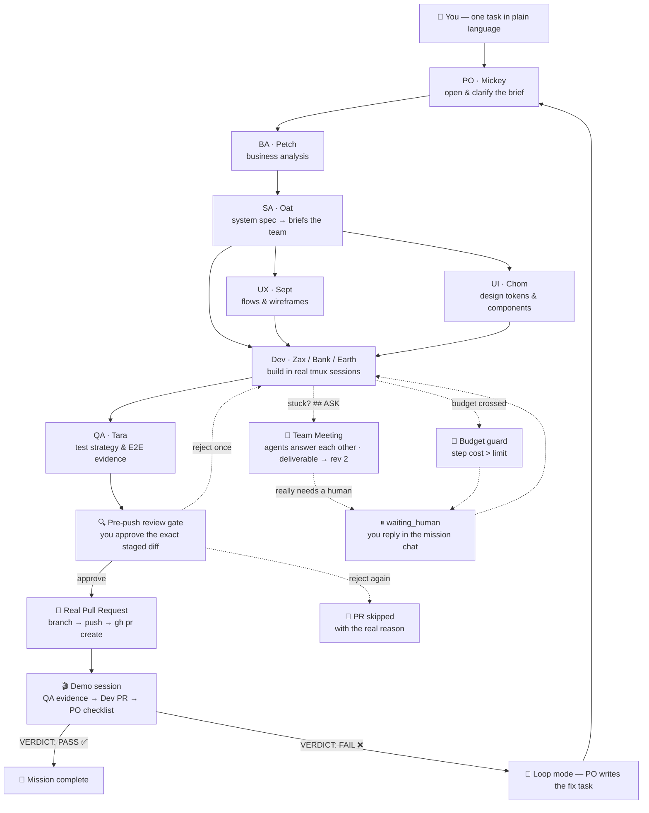

Everything streams live into Mission Control: agent nodes light up blue (working) / amber (meeting) / green (delivered), the ownership board shows who holds which slice (with the FE/BE parallel wave grouped together), the timeline shows each step with its real output, and every run is persisted (`data/runs.json`) so history survives restarts. Every mission is also a project task, so the same work can be tracked on the task board and opened subtask-by-subtask at stable URLs.

## 🏗 Architecture

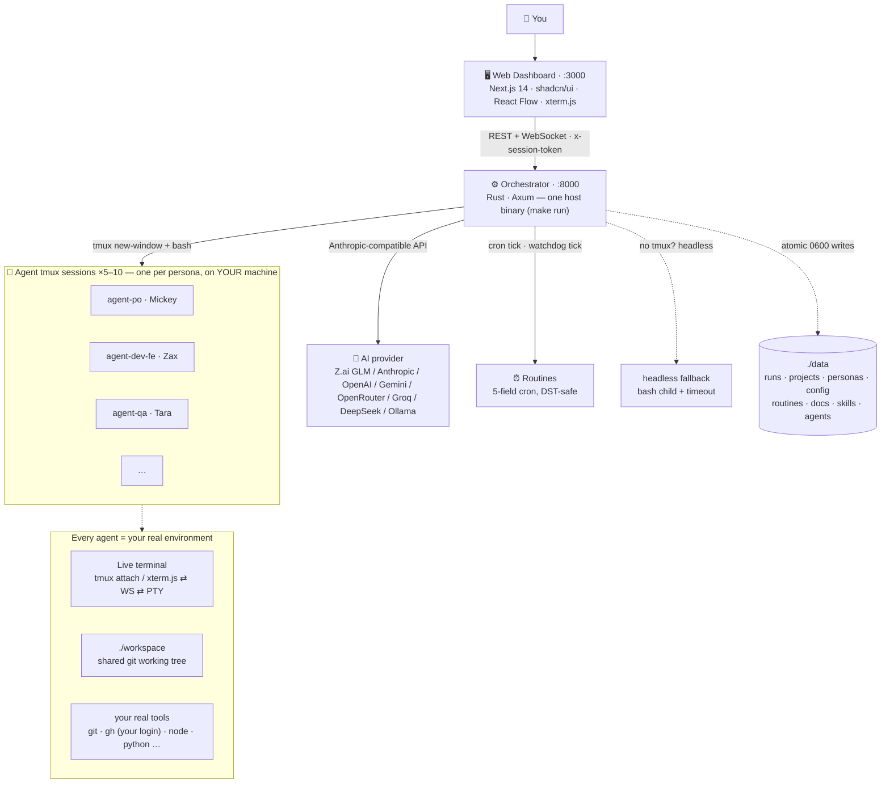

| Component | Stack | What it does |
|---|---|---|
| **Web** ([web/](web/)) | Next.js 14 (App Router), Tailwind, shadcn/ui, React Flow, xterm.js | Dashboard, Mission Control, task board + task/subtask drill-down, team & persona editor, org chart, routines, docs workspace, skills studio, AI config, connectors |
| **Orchestrator** ([orchestrator/](orchestrator/)) | Rust, Axum 0.8, tokio, portable-pty — a single host binary | Agent (tmux session) lifecycle, the Team Run engine (missions, meetings, budget guard, review gate, PR/demo stages), cron scheduler, watchdog, auth, connectors, tools manifest. Exec seam lives in [src/hostexec.rs](orchestrator/src/hostexec.rs) |

**Design principles**

- *One machine, one identity* — agents run with your real `$HOME`, your real tools, your real GitHub login; there is no per-agent sandbox to maintain, and nothing is ever installed behind your back (the tools manifest only *probes*)
- *Repo-first* — the orchestrator clones the project repo (depth 1) into a **shared `./workspace` directory**, so the whole team works on one working tree
- *Everything real* — deliverables, commits, PRs and test evidence are real artifacts; skipped stages say why
- *tmux = the window* — every command an agent runs is visible in its session, live, whether you watch from the web UI or your own terminal
- *Fail closed* — budgets stop spending instead of guessing, unpriced models block rather than record `$0`, and a hung harness is killed rather than left running in the background

## 👥 The AI team

| Role | Agent | Owns |
|---|---|---|
| Product Owner | **Mickey** | Opens the brief, coordinates, writes the mission summary, delivers the acceptance verdict |
| Business Analyst | **Petch** | Business requirements, success metrics, risks |
| System Analyst | **Oat** | Turns business → system spec (data model, API contracts), briefs the builders |
| UX Designer | **Sept** | User flows, IA, wireframes, unhappy paths |
| UI Designer | **Chom** | Visual design, design tokens, components |
| Frontend Dev | **Zax** | UI + API integration |
| Backend Dev | **Bank** | Services, API design, observability |
| Backend Dev | **Earth** | Data, migrations, CI/CD, reliability |
| QA Engineer | **Tara** | Test strategy, E2E (Playwright), quality gates |

Personas are editable from the AI Team page — role prompt, model override, harness, manager, skills.

## 🚀 Quickstart

```bash
git clone https://github.com/9zax/ai-agent-platform.git
cd ai-agent-platform

cp .env.example .env       # optional: set AI_API_KEY / ADMIN_PASSWORD now,
                           # or configure everything in the web UI later

make build                 # cargo release build + web production build
make run                   # orchestrator :8000 + web :3000, host processes
```

| Service | URL |
|---|---|
| Web dashboard | http://localhost:3000 |
| API | http://localhost:8000 |
| Any agent, live | `tmux attach -t agent-dev-fe` |

Start agents from the AI Team page, open a project, set a goal/budget if you want guardrails, type a task, press **สั่งงานทีม**, and watch Mission Control — or attach to any `agent-<role>` session and watch the same thing from your own terminal.

<details>
<summary><b>Environment variables</b> (all optional at boot)</summary>

| Variable | Default | Meaning |
|---|---|---|
| `AI_API_KEY` | *(empty)* | Provider API key — or set it in the **AI Config** page |
| `AI_BASE_URL` | *(empty)* | Custom endpoint — empty = provider default |
| `ADMIN_USER` | `admin` | Login username |
| `ADMIN_PASSWORD` | *(empty)* | **Empty = auth off (loopback only).** Set it to require login for the whole platform |
| `AAP_BIND` | `127.0.0.1:8000` (auth off) / `0.0.0.0:8000` (auth on) | Explicit listen address; override to expose on the LAN |
| `DATA_DIR` | `./data` | Runs, projects, project tasks (`project-tasks.json`), personas, config, routines, docs, skills, agents |
| `AAP_WORKSPACE` | `./workspace` | The team's shared working tree (cloned repos + deliverables) |
| `AAP_WATCHDOG_STALL_SECS` | `2700` | Minutes-without-heartbeat threshold for the advisory run watchdog (min 60s) |

</details>

## 🔐 Security notes

- **Private by default** — with `ADMIN_PASSWORD` unset the API listens on loopback only; every exec/terminal/agent endpoint requires a session when auth is on, and persona/task/config/skill mutations require auth too
- **Secrets stay server-side** — provider keys and GitHub PATs live in the orchestrator; the UI only shows masked keys; tokens in clone URLs are redacted from logs; secrets for an agent command ride a `0600` script file, never a command line (`ps` shows nothing)
- **Private at rest** — `data/` is `0700` and every store is written atomically as `0600` (tmp + rename); permissions are repaired on boot
- **Injection-resistant** — model-written PR titles/bodies go into `0600` files passed as quoted arguments, not shell heredocs; commands are single-quoted argument-by-argument
- **The review gate is a safety gate** — nothing is pushed until you approve the exact staged diff
- **One machine, one identity is a stated trade-off** — connecting GitHub logs the team in as you; disconnecting (or `gh auth logout`) logs the *machine* out. Agents work with your user's full permissions — this is a deliberate single-user design

## 🧪 Tests

```bash
make test    # runs the Playwright suite with .env credentials (needs the platform running)
cd orchestrator && cargo test   # unit tests: cron parsing, next-run, pricing, harness, review, watchdog, task titles/prompts
```

**19 spec files / ~59 Playwright cases** — auth gate, dashboard, agent detail, AI team + org view, projects, routines, docs workspace, board, connectors, inbox, skills studio, platform, plus mission dispatch, pause/resume, step retry, PR-auth flows and the task board → task drill-down.

## 📁 Repository layout

```
├── orchestrator/        # Rust backend (Axum) — API + mission engine + scheduler + watchdog
│   └── src/
│       ├── main.rs      #   routes, run engine, budget/review gates, cron, persistence
│       └── hostexec.rs  #   exec seam: tmux windows, headless fallback, timeouts
├── web/                 # Next.js dashboard
│   ├── app/             # pages: dashboard, projects (mission · tasks · task · subtask), containers, team, board, docs, skills, settings…
│   ├── components/      # sidebar, agent detail, human inbox, terminal, persona editor, task-ui, ui kit
│   └── e2e/             # Playwright specs + screenshot capture scripts
├── Makefile             # make build / run / test / migrate-state
├── docs/
│   ├── spec-agent-org.md    # org-features spec
│   └── screenshots/         # the images in this README
└── SPEC.md              # living spec & progress log (Thai)
```

## 🗺 Status & roadmap

Working today: the full loop above — team missions, meetings, human-in-the-loop, budgets with pause/resume, routines, pre-push review, loop mode, real PRs and demo acceptance, org ancestry, docs with comments, skill studio, BYO harnesses, watchdog — all on plain host processes with durable JSON stores.

Not built yet: vision QA (agents capturing and comparing screenshots), a GitHub OAuth permission-approval flow, multi-user roles/RBAC (single-user is by design), and database-backed persistence beyond the atomic JSON stores.

Detailed progress log lives in [SPEC.md](SPEC.md).

---

**Repository:** https://github.com/9zax/ai-agent-platform
