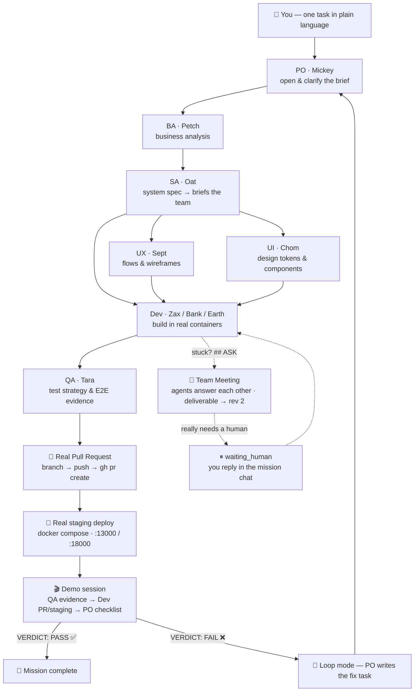
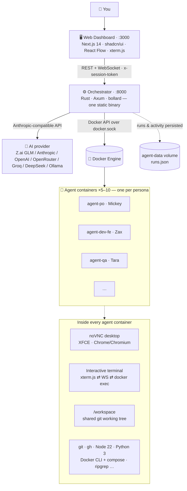

# AI Agent Platform

**A 9-agent AI software team that works in real Linux containers — live desktops you can watch, a real git repo, real pull requests, real staging deploys.**

Give the team one task in plain language. The Product Owner opens the brief, the Analysts break it down, Designers and Developers build it inside their own containers, QA verifies it — then a real PR is opened, the app is deployed to a real staging stack, and the PO runs a demo session to accept (or reject) the delivery with a verdict.

[](docs/screenshots/mission-control.png)

*A live mission on the React Flow canvas — each agent is a node, the timeline streams what they're doing, and meetings appear as floating cards wired to everyone involved.*

---

## 📸 The platform

| | |
|---|---|
| [](docs/screenshots/dashboard.png) | [](docs/screenshots/container-detail.png) |
| **Dashboard** — every agent container at a glance: state, image, role, live stats. | **Agent desktop** — a real Ubuntu + XFCE desktop (noVNC) inside the page: watch the agent use Chrome and the terminal live. |
| [](docs/screenshots/team.png) | [](docs/screenshots/board.png) |
| **AI Team** — 9 personas with role, model, skills and their own container. Edit personas in-place. | **Orchestrator board** — Kanban + live activity feed of what every agent is doing right now. |

## ✨ Highlights

- 🧑‍🚀 **9 role-playing agents, one real workflow** — PO → BA → SA → UX/UI → Dev → QA, each working in their *own* Docker container, each writing deliverables to a shared git working tree
- 🖥 **Live desktops** — every agent runs Ubuntu 22.04 + XFCE with a real browser; you watch them work through noVNC, or jump into an interactive terminal (xterm.js ⇄ WebSocket ⇄ `docker exec`)
- 🧠 **Team meetings & human-in-the-loop** — a stuck agent opens an `ASK` meeting and *other agents answer*; if it truly needs you, the run pauses (`waiting_human`) and your inbox pings — answer in the mission chat and the team continues
- 🐙 **Real pull requests** — the Dev creates a branch, pushes and opens a PR with `gh` from inside their container. No PR theater: if prerequisites are missing the step is *honestly skipped with the real reason*
- 🚀 **Real staging deploys** — the deploy stage runs `docker compose` against a separate `-staging` project (ports remapped to 13000/18000), then QA and Dev present evidence in a **demo session** while the PO checks acceptance criteria one by one → `VERDICT: PASS|FAIL`
- 🔁 **Loop mode** — after each round the PO evaluates the goal, writes the next task itself and re-runs the team (up to 8 rounds); a FAIL verdict forces a fix task
- 🔌 **Connectors** — GitHub (browser device-flow or PAT) and Figma (PAT), authorized per container from the UI
- 🛡 **Honest tools** — before every step the orchestrator probes what's really installed in the container and puts a *tools manifest* in the prompt: what exists (with versions) and what's forbidden to guess. Kills tool hallucination
- 🌐 **Any AI provider** — Z.ai GLM, Anthropic, OpenAI, OpenRouter, Groq, DeepSeek, Ollama (local) or a custom endpoint; switchable per persona from the AI Config page, keys stored server-side
- 🔐 **Login gate** — one `ADMIN_PASSWORD` unlocks everything (API, terminals, VNC); VNC single-sign-on means no second password
- 🧪 **51 Playwright E2E tests** across 14 spec files — covering the full container lifecycle, missions, pause/resume and PR auth

## 🎬 How a mission runs



Everything streams live into Mission Control: agent nodes light up blue (working) / amber (meeting) / green (delivered), the timeline shows each step with its real output, and every run is persisted (`runs.json`) so history survives restarts.

## 🏗 Architecture



| Component | Stack | What it does |
|---|---|---|
| **Web** ([web/](web/)) | Next.js 14 (App Router), Tailwind, shadcn/ui, React Flow, xterm.js | Dashboard, Mission Control, team & persona editor, Kanban board, settings, AI config, connectors |
| **Orchestrator** ([orchestrator/](orchestrator/)) | Rust, Axum 0.8, bollard, tokio — a single ~4.8k-line binary | Container lifecycle over the Docker API, the Team Run engine (missions, meetings, loop mode, PR/deploy/demo stages), auth, connectors, tools manifest |
| **Agent base** ([agent-base/](agent-base/)) | Ubuntu 22.04, XFCE (minimal), TigerVNC + noVNC, Chrome (amd64) / Chromium (arm64), Node 22, Python 3, git, gh, Docker CLI + compose v2 | One image for every agent — a real Linux desktop your AI works in |

**Design principles**

- *Repo-first* — the orchestrator clones the project repo (depth 1) into a **shared `/workspace` volume**, so the whole team works on one working tree, like bots on one Linux box
- *Everything real* — deliverables, commits, PRs, staging deploys and test evidence are real artifacts in real containers; skipped stages say why
- *Safety guard* — the platform only manages containers it created (label `managed-by=ai-agent-platform`)
- *Single-user trade-off, stated openly* — agents get `docker.sock` so they can deploy; that's root-equivalent and accepted for a personal platform

## 👥 The AI team

| Role | Agent | Owns |
|---|---|---|
| Product Owner | **Mickey** | Opens the brief, coordinates, writes the mission summary, delivers the acceptance verdict |
| Business Analyst | **Petch** | Business requirements, success metrics, risks |
| System Analyst | **Oat** | Turns business → system spec (data model, API contracts), briefs the builders |
| UX Designer | **Sept** | User flows, IA, wireframes, unhappy paths |
| UI Designer | **Chom** | Visual design, design tokens, components |
| Frontend Dev | **Zax** | UI + API integration |
| Backend Dev | **Bank** | Services, API design, observability |
| Backend Dev | **Earth** | Data, migrations, CI/CD, reliability |
| QA Engineer | **Tara** | Test strategy, E2E (Playwright), quality gates |

Personas are editable from the AI Team page — role prompt, model, skills, container mapping.

## 🚀 Quickstart

```bash
git clone https://github.com/9zax/ai-agent-platform.git
cd ai-agent-platform

cp .env.example .env       # optional: set AI_API_KEY / ADMIN_PASSWORD now,
                           # or configure everything in the web UI later

docker compose up --build -d

# optional: one example agent with a desktop you can peek at
docker compose --profile example up -d agent-example
```

| Service | URL |
|---|---|
| Web dashboard | http://localhost:3000 |
| API docs (OpenAPI) | http://localhost:8000/docs |
| Example noVNC desktop | http://localhost:6080 |
| Staging deploys (mission deploy stage) | http://localhost:13000 |

Create agents from the dashboard (pick a persona → a real container boots), open a project, type a task, press **สั่งงานทีม**, and watch Mission Control.

<details>
<summary><b>Environment variables</b> (all optional at boot)</summary>

| Variable | Default | Meaning |
|---|---|---|
| `AI_API_KEY` | *(empty)* | Provider API key — or set it in the **AI Config** page |
| `AI_BASE_URL` | *(empty)* | Custom endpoint — empty = provider default |
| `ADMIN_USER` | `admin` | Login username |
| `ADMIN_PASSWORD` | *(empty)* | **Empty = auth off.** Set it to require login for the whole platform (API, terminals, VNC) |

</details>

## 🔐 Security notes

- The login gate covers *all* container endpoints — exec, AI commands, lifecycle, VNC console; VNC single-sign-on reuses the session so there's no second password
- Provider keys and GitHub PATs live server-side in the orchestrator, never in the repo; the UI only shows masked keys; tokens injected into clone URLs are kept out of logs
- `.env` is gitignored — check `.env.example` for the shape
- Granting agents `docker.sock` is root-equivalent on the host; this is a deliberate single-user trade-off

## 🧪 Tests

```bash
cd web/e2e && npm install && npx playwright install chromium && npm test
```

**51 tests / 14 spec files** — auth, dashboard, container detail, AI team, projects, board, connectors, inbox, platform, plus mission dispatch, pause/resume and PR-auth flows.

## 📁 Repository layout

```
├── orchestrator/        # Rust backend (Axum + bollard) — API + mission engine
│   └── src/main.rs
├── web/                 # Next.js dashboard
│   ├── app/             # pages: dashboard, projects, containers, team, board, settings…
│   ├── components/      # sidebar, agent detail, human inbox, terminal panel, ui kit
│   └── e2e/             # Playwright specs (51 tests)
├── agent-base/          # Dockerfile + start.sh for the agent desktop image
├── docs/screenshots/    # the images in this README
├── docker-compose.yml   # orchestrator + web + example agent, shared volumes
└── SPEC.md              # living spec & progress log (Thai)
```

## 🗺 Status & roadmap

Working today: the full loop above — team missions, meetings, human-in-the-loop, loop mode, real PRs, staging deploys, demo acceptance, connectors, persisted history, 51 E2E tests.

Not built yet: vision/screenshot capability for agents, GitHub OAuth permission-approval flow, DB-backed persistence for personas/config (currently in-memory + `runs.json`).

Detailed progress log lives in [SPEC.md](SPEC.md).

---

**Repository:** https://github.com/9zax/ai-agent-platform
